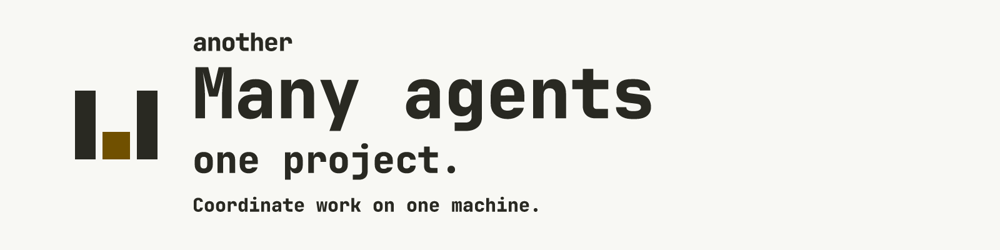

# Another



**Several agents, one project, one machine.**

[](https://github.com/tamler/another/actions/workflows/ci.yml) [](LICENSE) [](Cargo.toml) [](https://toanother.one/docs/install/) [](https://github.com/tamler/another/releases)

Another is a background messaging system that helps coding agents work on the same project on the same machine at the same time. It helps reduce editing conflicts, exchange updates and reuse registered resources. Free and open source, always. [Measured resource use](docs/RESOURCE-MEASUREMENTS.md) records a sample on one Mac and its limits.

It also works across machines today, through a self-hosted federation hub or authenticated remote peers. The hub can read mail it relays; remote peers cannot reap processes. See [federation](docs/FEDERATION.md) and [remote access](docs/REMOTE.md).

Claude Code and Codex cannot see each other without something shared. They can edit the same files, start the same fix twice, or launch duplicate model servers. Another combines path holds, messages and requests, activity, and a registry for ports and model servers. Its mailbox is a way to address agents and exchange messages. It does not launch agents, assign their work, or enforce a resource limit.

**Home:** [toanother.one](https://toanother.one) · **License:** [Apache-2.0](LICENSE) · **Status:** Milestones 1-6 complete. Hosted connectors (OAuth for ChatGPT, Claude, and other MCP clients) and the loopback dashboard are in this tree. See [docs/REMOTE.md](docs/REMOTE.md) and [docs/DASHBOARD.md](docs/DASHBOARD.md).

## Why

This is the failure I kept hitting:

- Two agents write the same file and the last save wins. Git shows the wreck. It does not say which session was in the file.
- Neither session can see the other, so both implement the fix.
- The handoff is me, copying a paragraph from one terminal to the other.
- A second agent starts another model server, or binds a port the first one already has.

What they get instead:

- **Path holds, taken at the edit.** With the hook pack, each file an agent edits gets an expiring hold, and a Claude Code, Codex or Grok CLI edit to a file another agent holds is stopped with the holder's name, across worktrees and clones of the same repo. `another hold check` exits 3 on overlap and grants nothing. Edits made from a shell command get past the hook, and Cursor has no edit guard, so use another checkout when you need a real boundary.
- **Mail and requests.** `another send --request` opens work for an agent to claim. Claiming assigns an owner. An ack records receipt. If the request goes stale, someone else can take it.
- **An activity feed**, so a session can ask who is doing what before it starts a duplicate.
- **A resource registry**, so an agent borrows a running server instead of launching a duplicate. `another reap` needs a human `--confirm` on that machine. Remote peers cannot reap.


Hooks put a short digest in at session start, and a one-line notice after the next tool call when mail lands mid-task. That is why the agents look.


State is one SQLite database on the machine (`~/.another`, or `$ANOTHER_HOME`). A second machine can federate through a hub you host. The hub can read mail it relays.

OAuth for hosted MCP clients (ChatGPT, Claude.ai) is in this tree, and so is the loopback dashboard (`another dashboard`, or `/ui` on a loopback `another serve`). See the [changelog](https://toanother.one/changelog/) and [how I run the agents on this repo](https://toanother.one/building/).

The website source lives in [site/](site/README.md). `sh site/build.sh` checks the pages, and `python3 scripts/check-copy.py` rejects em dashes and a banned-phrase list.

## Quickstart

**1. Install** with Rust 1.88 or newer:

```bash
cargo install --locked --git https://github.com/tamler/another another
```

Or build from a checkout (the binary ends up at `target/release/another`):

```bash
git clone https://github.com/tamler/another && cd another && cargo build --release --locked
```

Once v0.1.0 is published, prebuilt binaries for macOS (arm64, x86_64) and Linux (static, x86_64, arm64) will be on [GitHub Releases](https://github.com/tamler/another/releases): unpack one and put `another` on your `PATH`. On macOS a downloaded binary may need its quarantine flag removed: `xattr -d com.apple.quarantine ./another`.

On macOS, when replacing an existing `another` with a new build, **remove the old binary first** (`rm "$(command -v another)"`) and then copy the new one in. Copying over the old file in place leaves a stale code signature cached, and macOS kills the new binary on launch. `cargo install` replaces it safely.

After upgrading, restart every `another` process that was already running, since it keeps the old code: run `another daemon restart` on macOS (or `another daemon install` from the new binary if it lives at a different path; on Linux, restart your service), restart each client that runs `another serve --stdio` (or reconnect its MCP server), and restart any `another remote up`, `another serve --auth` or hand-started `another serve`. This matters most when the upgrade changes how repository keys are cached, as the one after #103 does: an old process reading keys written by the new one does not see holds in sibling worktrees and lets those edits through. See [docs/DAEMON.md](docs/DAEMON.md#upgrading).

**2. Create the local node** (`~/.another`, or `$ANOTHER_HOME`):

```bash
another init
```

**3. Let agents check mail automatically** (Claude Code, Codex, Grok CLI, Cursor). This installs **user-global** hooks in each client's home-directory config (e.g. `~/.claude/settings.json`, `~/.codex/hooks.json`), not per project. It is idempotent, backs up the files it changes, keeps their permissions (a `0600` settings file stays `0600`), and never overwrites your existing hooks:

```bash
another hook install --client all
```

For Codex, review and trust Another's new or changed hooks yourself in `/hooks`. In Codex's default trust flow, automatic mail delivery, heartbeats and edit holds do not run there until you do. Codex also offers `--dangerously-bypass-hook-trust`, which runs enabled hooks without persisted trust for that one invocation; Another does not recommend it. `another hook status` checks configuration presence, not trust or execution. Another cannot grant trust. See [Codex trust and coverage](docs/HOOKS.md#codex-trust-and-coverage).

Besides session start, prompts and session end, the pack adds a hook after each tool call (new mail shows up mid-task) and, for Claude Code, Codex and Grok, one before each file edit (the edit takes a hold, or is stopped when another agent holds the file). Both fail open. See [docs/HOOKS.md](docs/HOOKS.md).

**Optional: keep the daemon running** (macOS). It expires holds in the background and wakes idle Herdr agents when mail arrives:

```bash
another daemon install
```

**4. Give agents the MCP tools.** Add Another as a stdio MCP server in each client:

```json
{ "mcpServers": { "another": { "command": "another", "args": ["serve", "--stdio"] } } }
```

Or run one loopback daemon and point clients at `http://127.0.0.1:7466/mcp`:

```bash
another serve
```

**ChatGPT desktop on this Mac** uses that same local server. In the app: Settings → MCP servers → Add server → STDIO, command `another`, arguments `serve --stdio`, then Restart. Or Streamable HTTP with the URL `http://127.0.0.1:7466/mcp` while `another serve` is running. No tunnel and no OAuth. The app writes this to `~/.codex/config.toml`, which Codex shares. A cloud ChatGPT chat, including developer-mode plugins, does not use that file; those connectors are called from OpenAI and need a public URL or OpenAI's Secure MCP Tunnel. Details and links: [docs/REMOTE.md](docs/REMOTE.md).

**5. Try it from the shell:**

```bash
another agent register alice --program claude
```

```bash
another agent register bob --program codex
```

```bash
another send --from alice --to bob --subject "Review PR 12" --body "please" --request
```

```bash
another inbox --agent bob
```

```bash
another activity --summary
```

That exchange, recorded from a temporary home with a build of `main` (ids and timestamps will differ; the hold check exits 3 on purpose):


**6. Open the local dashboard** (loopback only, no extra install):

```bash
another dashboard
```

Or, while `another serve` is running, open <http://127.0.0.1:7466/ui>. The page is served by the binary. It does not call out to a CDN.

## Status

| Milestone | Scope | Status |
|---|---|---|
| 1 | Local core: SQLite event log, agents, mail, requests, path holds, MCP (stdio + loopback HTTP), CLI | ✅ tamler/another#1 |
| 2 | Mail checking: activity feed + summary, session events, hook packs, `another hook install` | ✅ tamler/another#2 |
| 3 | Resource registry: shared/exclusive leases, orphan scanner, human-approved reap | ✅ tamler/another#3 |
| 4 | Authenticated remote peer (Grok Bot): scoped bearer tokens, audit log, `GET /activity` | ✅ tamler/another#4 |
| 5 | Federation (v2): signed event logs, pairing, hub-and-spoke sync, cross-node mail | ✅ tamler/another#5 |
| 6 | Polish: `another wake` (tmux, cmux, Herdr), Herdr plugin, release builds, quickstart, CONTRIBUTING | ✅ complete |
| 7 | Hosted connectors: OAuth 2.1 on the authenticated server, local approval, `another remote up`, `whats_new`, ChatGPT desktop local MCP | ✅ tamler/another#99 |
| - | Local dashboard: agents, holds, mail, requests, resources, timeline, peers | ✅ [docs/DASHBOARD.md](docs/DASHBOARD.md) |
| - | Push and enforced holds: mid-task notices, edit guard, holds across worktrees, launchd daemon, Herdr wakes, `another stats` | ✅ tamler/another#103, #104, #105 ([docs/HOOKS.md](docs/HOOKS.md), [docs/HOLDS.md](docs/HOLDS.md), [docs/DAEMON.md](docs/DAEMON.md)) |

Current brief: [AGENTS.md](AGENTS.md). Milestone 7 is the connectors work. Bearer tokens from milestone 4 still work. Every milestone merges only with CI green: test, clippy `-D warnings`, fmt, MSRV 1.88, copy lint.

## Guides

| Doc | What it covers |
|---|---|
| [docs/HOOKS.md](docs/HOOKS.md) | Hook packs for each client; trust steps; the digest; mid-task notices; the edit guard; failing open |
| [docs/HOLDS.md](docs/HOLDS.md) | Path holds, holds across worktrees of one repository, whole-project holds |
| [docs/DAEMON.md](docs/DAEMON.md) | The background daemon (launchd), waking idle Herdr agents, `another stats` |
| [docs/RESOURCES.md](docs/RESOURCES.md) | Resource registry, orphans, human-approved reaping |
| [docs/REMOTE.md](docs/REMOTE.md) | Remote peers: bearer tokens, OAuth for ChatGPT and Claude, tunnels, audit log |
| [docs/FEDERATION.md](docs/FEDERATION.md) | Several machines: node keys, pairing, sync, permissions |
| [docs/WAKE.md](docs/WAKE.md) | `another wake` adapters (tmux, cmux, Herdr) and the Herdr plugin |
| [docs/DASHBOARD.md](docs/DASHBOARD.md) | Local web dashboard (`another dashboard`, `GET /ui`) |
| [docs/SPEC.md](docs/SPEC.md) | Research and product spec |
| [docs/DECISIONS.md](docs/DECISIONS.md) | Locked defaults and every design decision made while building |
| [CONTRIBUTING.md](CONTRIBUTING.md) | How to contribute (clean-room rules, checks, MSRV) |

## MCP tools

| Area | Tools |
|---|---|
| Identity | `ensure_project`, `register_agent`, `heartbeat` (`start` / `end` record sessions) |
| Mail | `send_message` (with `reply_to`, `create_request`), `fetch_inbox`, `threads`, `acknowledge` |
| Requests | `claim_request` (`claim` / `release` / `complete` / `cancel`) |
| Path holds | `hold_paths` (`acquire` / `check` / `renew` / `release` / `list`) |
| Awareness | `whats_new` (one-call catch-up: unread subjects, open requests, recent activity), `activity_feed`, `activity_summarize` (summaries and ids, never message bodies) |
| Resources | `resource_find`, `resource_register`, `resource_borrow`, `resource_release`, `resource_heartbeat`, `orphans_list`, `resource_reap` (plan and request only) |

Tool errors are `{"error": {"code", "message", "hint?"}}` with codes `not_found`, `invalid`, `conflict`, `ambiguous`, `forbidden`. `hint`, when present, says the next call to make.

## CLI at a glance

Every command takes `--json`. `--agent` and `--from` default to `$ANOTHER_AGENT`, and `--project` defaults to the current directory.

Logs go to stderr: `info` and above for `another serve`, `warn` and above for every other command. Set `$ANOTHER_LOG` to a [tracing filter](https://docs.rs/tracing-subscriber/0.3/tracing_subscriber/filter/struct.EnvFilter.html#directives) such as `debug` or `another::serve=warn` to change this; a value that does not parse is ignored.

| Task | Commands |
|---|---|
| Node | `another init`, `another status`, `another node show`, `another node name [<name>]` (no name prints the current one), `another events` |
| Agents | `another agent register <name> --program claude\|codex\|grok\|cursor\|grok_bot\|other [--project PATH]`, `another agent list` |
| Mail | `another send`, `another inbox`, `another reply <message-id>`, `another ack <message-id>`, `another threads`, `another thread <id>` (there is no `another mail` command) |
| Requests | `another requests`, `another request claim\|release\|complete\|cancel <id>` (recorded walkthrough: [docs/REQUESTS.md](docs/REQUESTS.md)) |
| Holds | `another hold acquire\|check\|renew\|release`, `another holds` (conflicts exit with status 3; `--repo-wide` for a whole-project hold) |
| Sessions and feed | `another heartbeat [--start\|--end [--keep]]`, `another activity [--since 1h] [--kinds mail,request] [--summary]`, `another stats [--since 48h]` |
| Hooks | `another hook install\|uninstall --client <c>\|all [--dry-run]`, `another hook status` |
| Daemon | `another daemon install\|uninstall\|status\|restart` (macOS launchd), `another serve [--no-wake]` |
| Resources | `another resources`, `another resource register`, `another borrow`, `another release`, `another orphans`, `another reap <target> [--confirm]` |
| Remote peers | `another serve --auth`, `another remote up`, `another token create\|list\|revoke`, `another oauth approve\|deny\|list\|revoke`, `another audit` |
| Federation | `another pair invite\|join\|revoke`, `another peers`, `another sync [--watch]`, `another serve --federation` |
| Wake | `another wake [--agent X\|--all]`, `another wake set\|clear\|list\|prune` |
| Dashboard | `another dashboard` (loopback UI), or `GET /ui` on a loopback `another serve` |

## Concepts

- **Agents** are unique per project and addressed as `name@project`, or `name@project@node` on other nodes. A bare `name` works when it is unambiguous; once a second project registers the same name it stops resolving, and [docs/ADDRESSING.md](docs/ADDRESSING.md) shows the error and the fix.
- **Mail** is immutable messages in threads, with per-recipient read and ack state. **Requests** go `open → claimed → done`; claiming assigns an owner. They become `stale` past their due time and anyone may take them over. An ack records receipt, not completion: [docs/REQUESTS.md](docs/REQUESTS.md) walks through a worker that acks, claims, and crashes.
- **Path holds** are expiring leases on project-relative globs. Exclusive holds conflict with overlapping holds, including holds in other checkouts of the same repository on this machine. The edit hook enforces them for client file edits; across machines, a clash is a warning, never a lock.
- **Resources** are model and dev servers, ports, GPUs, containers and jobs, held by owner and borrower leases with TTLs. Orphans are listed, and only a human can reap them (`another reap … --confirm`); reaping is never remote.
- **Event log**: every change is appended to a signed, chained, append-only log, and the query tables are projections of it. That log is what federation syncs.
- [docs/GLOSSARY.md](docs/GLOSSARY.md) defines every term and sets the easily confused pairs side by side: an ack versus request ownership, a path hold versus a resource lease, and what expiry means for each.

## Safety defaults

- Binds to loopback only, unless you pass `--auth` and `--allow-remote-bind`.
- The dashboard is loopback-only. An `--auth` server does not serve it unless you pass `--dashboard`, and then it is read-only with message bodies omitted. Its `Host` must still be loopback on the bound port, not a tunnel name.
- Remote tokens and OAuth grants each act as a single agent within project globs. A hosted client is approved on this machine; it is never approved by an HTTP request. Every remote call is audited.
- Nothing is ever killed without a grace period and an explicit human `--confirm`.
- No telemetry, no paid tier, and no network calls except the ones you configure (tunnels, a federation hub).

## Development

```bash
cargo test
```

```bash
cargo clippy --all-targets --all-features -- -D warnings
```

```bash
cargo fmt --all -- --check
```

See [CONTRIBUTING.md](CONTRIBUTING.md). The minimum supported Rust version is 1.88.

## Clean-room

Written from this repository's own spec. Do **not** copy code from MCP Agent Mail or any other project with a non-permissive license or license rider.
