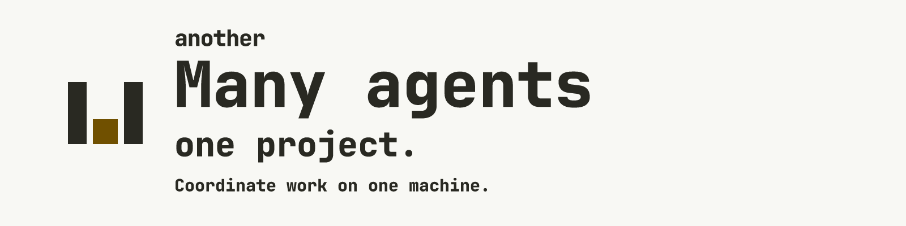

# Another



**Several agents, one project, one machine.**

[](https://github.com/tamler/another/actions/workflows/ci.yml) [](LICENSE) [](Cargo.toml) [](https://toanother.one/docs/install/) [](https://github.com/tamler/another/releases)

Another is a background messaging system that helps coding agents work on the same project on the same machine at the same time. It helps reduce editing conflicts, exchange updates and reuse registered resources. Free and open source, always. [Measured resource use](docs/RESOURCE-MEASUREMENTS.md) records a sample on one Mac and its limits.

## Quickstart

Install Git, Rust 1.88 or newer, and your platform's linker and build tools. See the instructions for [macOS](https://toanother.one/docs/install/macos/), [Linux](https://toanother.one/docs/install/linux/), or [experimental native Windows](https://toanother.one/docs/install/windows/). The project currently distributes source through GitHub.

```sh
cargo install --locked --git https://github.com/tamler/another another
another --version
```

Make sure Cargo's bin directory is on your `PATH`. In a test repository or a shared checkout where both agents will work, run:

```sh
another init
another agent register alice --program claude --project .
another agent register bob --program codex --project .
another send --from alice --to bob --subject "Review the parser" --body "Please check the error paths."
another inbox --agent bob --unread
```

Bob should see Alice's unread message. Both demo identities use this checkout and the same database, stored in `~/.another` by default. Set `ANOTHER_HOME` before initialization to use a separate database. Each client that shares it must inherit the same setting.

Check how path holds work in the same checkout. The second command should report Alice's hold and exit with status 3. Run the release even after that expected conflict.

```sh
another hold acquire --agent alice src/parser.rs
another hold check --agent bob src/parser.rs
another hold release --agent alice src/parser.rs
```

[Message delivery](docs/INBOX.md) shows how to acknowledge and reply. [Requests](docs/REQUESTS.md) cover work addressed to a particular agent.

### Try the work queue in a test database

Run this in a fresh test database after registering Alice and Bob. Use the item number from the proposal in place of `Q1` if it differs. Run the admission command in an interactive terminal and type `yes` when prompted.

```sh
another queue propose --agent alice --title "Review the parser" --scope parser-review --done-when "Review recorded"
another queue admit Q1 --owner
another queue next --agent bob
another queue done Q1 --agent bob --summary "Review recorded" --file notes.md
```

Bob should receive the admitted item. The result records the summary and a file reference. See the [work queue guide](docs/QUEUE.md) for claim limits and handoffs.

### Connect real agent sessions

Preview the hooks for the clients you use, then install them. These commands write user-level client settings. The installer preserves existing hooks and backs up changed files.

```sh
another hook install --client claude,codex --dry-run
another hook install --client claude,codex
another hook status
```

In Codex, review and trust the installed hooks in `/hooks`. Start new sessions in the same checkout. Hooks register client-based identities and show messages at session start, at prompts, and after a tool call. Run `another agent list` to find the actual addresses. A client can also use MCP to read and send messages itself. Configure it to launch `another serve --stdio` with the same project and data directory. See [client setup](docs/HOOKS.md) and [MCP connections](https://toanother.one/docs/#connections).

Path holds help Claude Code, Codex and Grok CLI avoid conflicting edits when the edit hook runs. Shell writes bypass the hook, Cursor has no edit guard, and separate checkouts have separate holds. The [daemon](docs/DAEMON.md) can expire holds and wake idle Herdr sessions. The experimental [resource registry](docs/RESOURCES.md) helps agents reuse model servers and ports.

On macOS, `another daemon status` checks the loaded label's recorded `ANOTHER_HOME`; on Linux it reads the installed systemd unit's `ANOTHER_HOME`. If it belongs to a different home or cannot be verified, status says so and does not report that daemon's PID or health as this home's.

On macOS and Linux, `another doctor` also reads `ANOTHER_HOME` from the installed service definition and flags a different home. Daemon status distinguishes an address it cannot reach, a bind that is not numeric loopback, and a health response that does not identify this home's node.

Daemon status reports healthy only when `/health` identifies this home's node. `another doctor` checks the service manager on both macOS and Linux.

For upgrades and local source installs, see the [install guide](https://toanother.one/docs/install/) and [upgrade checklist](docs/DAEMON.md#upgrading). For a second machine, see [self-hosted federation](docs/FEDERATION.md). A hub can read the messages it relays. [Authenticated remote peers](docs/REMOTE.md) and the [dashboard](docs/DASHBOARD.md) are experimental.

Normal builds expose only signed federation exchange. Library compatibility tests can enable the `another` crate's `test-support` feature to simulate an older unsigned node; workspace tests enable it automatically. Keep that feature off in shipped builds.

## Status

Federated holds follow the node that took them. Ownership collisions appear in the audit log and sync report; `another doctor` reports inconsistent legacy holds and orphan holds with missing references. Batch audit summaries distinguish the delivering peer from the events' signing origins. See [federation](docs/FEDERATION.md#model).

Hosted Windows CI runs the workspace tests, including CLI thread exit-status checks, and the fresh-install, hook-pack and daemon dry-run checks. The forced small-stack test uses Unix `ulimit`; Windows exercises the CLI with its native main-thread stack. Install upgrades from the pre-Windows schema-v8 build are checked on Linux and macOS.

Security hardening: local listener scans match only local resource registrations, and terminal text flattens Unicode line and paragraph separators. On Unix, database files and build records are created owner-only (0600), and normal database opens tighten those existing files too. Federation hub calls refuse redirects, and unknown pairing invites are refused before taking the write transaction. A push or pull is signed for one hub and one nonce, and the hub records each nonce it serves, so a captured sync request cannot be sent again. When updating a hub and its spokes, update the spokes first: a new spoke still syncs with an older hub, and a new hub tells an older spoke to update ([docs/FEDERATION.md](docs/FEDERATION.md)).

Hub backups are secret material: they contain the node's private signing key, mail and authentication records. Keep them owner-only and protect every copy. Unauthenticated rejection audits are capped at 32 rows per server store per 60 seconds, including summaries. Omitted refusals are summarized on the next audit write after the window closes, at most once per 60 seconds.

| Milestone | Scope | Status |
|---|---|---|
| 1 | Local core: SQLite event log, agents, messages, requests, path holds, MCP (stdio + loopback HTTP), CLI | ✅ tamler/another#1 |
| 2 | Message notices: activity feed + summary, session events, hook packs, `another hook install` | ✅ tamler/another#2 |
| 3 | Resource registry: shared/exclusive leases, orphan scanner, human-approved reap | ✅ tamler/another#3 |
| 4 | Authenticated remote peer (Grok Bot): scoped bearer tokens, audit log, `GET /activity` | ✅ tamler/another#4 |
| 5 | Federation (v2): signed event logs, pairing, hub-and-spoke sync, cross-node messages | ✅ tamler/another#5 |
| 6 | Polish: `another wake` (tmux, cmux, Herdr), Herdr plugin, release builds, quickstart, CONTRIBUTING | ✅ complete |
| 7 | Hosted connectors: OAuth 2.1 on the authenticated server, local approval, `another remote up`, `whats_new`, ChatGPT desktop local MCP | ✅ tamler/another#99 |
| - | Local dashboard: agents, holds, messages, requests, resources, timeline, peers | ✅ [docs/DASHBOARD.md](docs/DASHBOARD.md) |
| - | Push and enforced holds: mid-task notices, edit guard, holds scoped to a checkout, launchd daemon, Herdr wakes, `another stats` | ✅ tamler/another#103, #104, #105 ([docs/HOOKS.md](docs/HOOKS.md), [docs/HOLDS.md](docs/HOLDS.md), [docs/DAEMON.md](docs/DAEMON.md)) |
| - | Read-only work board: holds, recent and stopped edits, what is waiting on whom, per project (`another board`, `work_board`) | ✅ [docs/BOARD.md](docs/BOARD.md) |
| M1 | Work queue for one node: propose, admit (owner or delegate, recorded), atomic `next` with per-agent limits, results, handoff, the owner list and the audit (`another queue`, `queue_*` tools) | Built: [docs/QUEUE.md](docs/QUEUE.md). M1's done condition also needs the three-day fleet run, which has not happened yet |
| M2 | Results and the lapse rule: claims, handoffs and results are events and a result is stored on its item; a claim returns to ready, with its history and a message to the agent that held it, at the end hook of the session that made it or after the grace period (24 hours by default) with no sign of life | Built: [docs/QUEUE.md](docs/QUEUE.md#when-a-claim-is-released-automatically). Only Claude Code claims are bound to a session; release on the transport's confirmed-gone signal is still to come |
| - | Upgrade safety (the code half of v0.1.0 scope M3): a checked backup before any migration, unknown schemas refused, development builds keep to their own homes, `another doctor` reports a build and database mismatch | ✅ tamler/another#260 ([docs/DOCTOR.md](docs/DOCTOR.md#upgrades-and-backups)) |
| M5 | Transport interface: `wake`, `status` and `list`; the Herdr transport; command transports configured in `transports.json`, which replace the built-in tmux and cmux adapters; one row per agent session; a wake that does not start work is recorded as failed and shown; blocked, stuck and vanished sessions in `another transport status` | Built: [docs/WAKE.md](docs/WAKE.md). The remaining live checks against Herdr are still to come, the command transports have been run against fake programs only, and the confirmed-gone signal ships switched off |
| M7 | One list of what needs the owner: proposals to decide, sessions that are blocked, stuck or unreachable, quiet claims and ready items nobody can take, each with its next step (`another needs`); read-only and local | Built: [docs/NEEDS.md](docs/NEEDS.md). The other half of M7, the read-only scan in `another doctor` for lapsed resources and unregistered listeners, is built too ([docs/DOCTOR.md](docs/DOCTOR.md)) |
| M9 (Q31) | Pre-tag security fixes: federation-only listener (`--federation` without `--auth`) serves only `/fed/*` and `/health`, token-gated federation dashboards, hook-quoted wake subjects and edit denials, bounded unauthenticated rejection audits, read-only invalid token checks, bounded IP-literal foreign resource probes | ✅ tamler/another#281 ([docs/FEDERATION.md](docs/FEDERATION.md), [docs/REMOTE.md](docs/REMOTE.md)) |
| M-A, M-B, M-C, M-E | Admitted FLE-23 pre-tag consolidations: shared time helpers and bare-seconds support (`M-A`), shared crypto helpers with constant-time digest compare (`M-B`), shared git-root/path/`shell_word` helpers (`M-C`), and `test-support` forged-event helpers (`M-E`). See the completed and open work in the [27 Nov admissions](docs/V0.1.0-SCOPE.md#admitted-27-nov-2026-by-the-pm-delegate-fle-23-follow-through). M-T waits for the owner's admission. | ✅ tamler/another#287, #294, #283, #284, #282 ([docs/V0.1.0-SCOPE.md](docs/V0.1.0-SCOPE.md#admitted-pre-tag-consolidations-fle-23)) |

**Now: v0.1.0.** The milestones above are what is on `main`. The [vision](docs/VISION.md) and the [scope approved on 17 Nov 2026](docs/V0.1.0-SCOPE.md) set the plan for the single-node queue release, with a target tag date of 1 Dec 2026. The [roadmap](docs/ROADMAP.md) tracks prebuilt binaries, remaining security fixes and one lease model before the first tag (D105 to D109). Cross-node queue claims follow in v0.2.0. Hosted connectors (OAuth), bearer-token peers, reaping, the dashboard, native Windows features and external commands are frozen and get only security and data-loss fixes. Windows x86_64 prebuilt binaries are an approved packaging exception (D105).

Current brief: [AGENTS.md](AGENTS.md). Every change merges only with CI green: test, clippy `-D warnings`, fmt, MSRV 1.88, copy lint.

Superseded pull request CI runs are canceled. Pull requests and pushes to `main` trigger fuzzing when they change files under `crates/` or `fuzz/`, `Cargo.lock`, or the fuzz workflow. Pull requests run a 60-second smoke per target with a 15-minute job limit. Pushes to `main`, the weekly run on Mondays at 04:17 UTC (12:17 p.m. Asia/Manila), and manual runs fuzz each target for 300 seconds by default with a 30-minute job limit. Manual overrides accept whole seconds from 1 to 1800 and use a 40-minute job limit for values other than the default.

## Guides

Task guides, all listed on the [guides hub](site/guides/index.html) (website source): [Claude Code + Codex](site/guides/claude-code-codex/index.html), [coordinate local agents](site/guides/coordinate-local-agents/index.html), [multiple Claude Code sessions](site/guides/multiple-claude-code-sessions/index.html), [MCP messaging](site/guides/mcp-agent-messaging/index.html), [file holds](site/guides/avoid-agent-file-conflicts/index.html), [git worktrees](site/guides/git-worktrees/index.html), [hand off a task](site/guides/hand-off-tasks/index.html), [share a model server](site/guides/share-model-server/index.html), [wake idle agents](site/guides/wake-idle-agents/index.html) and [agents on two machines](site/guides/agents-on-two-machines/index.html).

| Doc | What it covers |
|---|---|
| [docs/HOOKS.md](docs/HOOKS.md) | Hook packs for each client; trust steps; the digest; mid-task notices; the edit guard; failing open |
| [docs/HOLDS.md](docs/HOLDS.md) | Path holds, releasing a file by path, holds and checkouts, whole-project holds |
| [docs/DAEMON.md](docs/DAEMON.md) | The background daemon (launchd, systemd user unit, Task Scheduler), waking idle Herdr agents, `another stats` |
| [docs/RESOURCES.md](docs/RESOURCES.md) | Resource registry, orphans, human-approved reaping |
| [docs/REMOTE.md](docs/REMOTE.md) | Remote peers: bearer tokens, OAuth for ChatGPT and Claude, tunnels, audit log |
| [docs/FEDERATION.md](docs/FEDERATION.md) | Several machines: node keys, pairing, sync, permissions |
| [docs/WAKE.md](docs/WAKE.md) | Waking agents through a transport: the interface, the Herdr transport, sessions, `another wake`, `another transport status`, command transports (tmux, cmux, any tool with a CLI), the Herdr plugin |
| [docs/DASHBOARD.md](docs/DASHBOARD.md) | Local web dashboard (`another dashboard`, `GET /ui`) |
| [docs/BOARD.md](docs/BOARD.md) | `another board`: who holds what, recent and stopped edits, pending handoffs, per project; writes nothing |
| [docs/QUEUE.md](docs/QUEUE.md) | The work queue: proposing, admitting, `next`, limits, results, the owner list, the audit, and what the authority checks do not protect against |
| [docs/NEEDS.md](docs/NEEDS.md) | `another needs`: the one list of what needs the owner, the next step for each row, `--brief` for a prompt, `--json` for a coordinating agent; writes nothing |
| [docs/PLUGINS.md](docs/PLUGINS.md) | External commands: `another <name>` runs `another-<name>` from `PATH`; the rules and the trust model |
| [examples/](examples/README.md) | Runnable scripts on one machine: a two-agent review handoff, and a federation hub with two spokes |
| [docs/VISION.md](docs/VISION.md) | Purpose, users, principles and non-goals |
| [docs/V0.1.0-SCOPE.md](docs/V0.1.0-SCOPE.md) | What v0.1.0 must have, may have, freezes and cuts |
| [docs/COMPETITORS.md](docs/COMPETITORS.md) | Zipline, Polyroom and KittyClaw against Another: capability table, gaps, and claims we can back |
| [docs/SPEC.md](docs/SPEC.md) | Original research and product spec (historical) |
| [docs/DECISIONS.md](docs/DECISIONS.md) | Locked defaults and every design decision made while building |
| [CONTRIBUTING.md](CONTRIBUTING.md) | How to contribute (clean-room rules, checks, MSRV) |

## MCP tools

| Area | Tools |
|---|---|
| Identity | `ensure_project`, `register_agent`, `heartbeat` (`start` / `end` record sessions; setting both returns `invalid` on local, bearer-token and hosted OAuth MCP) |
| Messages | `send_message` (with `reply_to`, `create_request`), `fetch_inbox`, `threads`, `acknowledge` |
| Requests | `claim_request` (`claim` / `release` / `complete` / `cancel`) |
| Work queue | `queue_propose`, `queue_next` (returns `{claimed, refused}`), `queue_update` (`note` / `release` / `handoff` / `done`), `queue_list`. Local callers only; no tool admits, rejects or edits an item ([docs/QUEUE.md](docs/QUEUE.md)) |
| Path holds | `hold_paths` (`acquire` / `check` / `renew` / `release` / `list`) |
| Awareness | `whats_new` (one-call catch-up: unread subjects, open requests, recent activity), `activity_feed`, `activity_summarize` (summaries and ids, never message bodies), `work_board` (read-only: holds, recent and stopped edits, pending handoffs per project) |
| Resources | `resource_find`, `resource_register`, `resource_borrow`, `resource_release`, `resource_heartbeat`, `orphans_list`, `resource_reap` (plan and request only) |

Tool errors are `{"error": {"code", "message", "hint?"}}` with codes `not_found`, `invalid`, `conflict`, `ambiguous`, `forbidden`. `hint`, when present, says the next call to make.

## CLI at a glance

Every command takes `--json`. `--agent` and `--from` default to `$ANOTHER_AGENT`, and `--project` defaults to the current directory.

Logs go to stderr: `info` and above for `another serve`, `warn` and above for every other command. Set `$ANOTHER_LOG` to a [tracing filter](https://docs.rs/tracing-subscriber/0.3/tracing_subscriber/filter/struct.EnvFilter.html#directives) such as `debug` or `another::serve=warn` to change this; a value that does not parse is ignored.

| Task | Commands |
|---|---|
| Exit status | `0` success, `1` error, `2` bad arguments, `3` conflict (holds that overlap, acting on a closed request, claiming or completing a request another agent has claimed). A `forbidden` error, such as releasing a request someone else owns, exits 1. An error prints `another: <what happened>` and, when the next step is not obvious, a `hint:` line; `--json` prints `{"error": {"code", "message", "hint?"}}` on stdout |
| Node | `another init`, `another status`, `another node show`, `another node name [<name>]` (no name prints the current one), `another events` |
| Agents | `another agent register <name> --program claude\|codex\|grok\|cursor\|grok_bot\|other [--project PATH]`, `another agent list` |
| Messages | `another send`, `another inbox`, `another reply <message-id>`, `another ack <message-id>`, `another threads`, `another thread <id>` |
| Requests | `another requests`, `another request claim\|release\|complete\|cancel <id>` (recorded walkthrough: [docs/REQUESTS.md](docs/REQUESTS.md)) |
| Work queue | `another queue propose\|list\|show\|next\|note\|release\|done` for agents; `another queue admit\|reject\|edit` for the owner (`--owner`, at a terminal) or a delegate (key in `$ANOTHER_ADMIT_KEY`); `another queue limit set\|default\|list`, `another queue delegate add\|remove\|list`, `another queue grace [<duration>]`, `another queue list --needs-owner`, `another queue audit` (`next` exits with status 3 when the agent is at its limit; [docs/QUEUE.md](docs/QUEUE.md)) |
| What needs the owner | `another needs [--brief] [--limit N]` (read-only; exits 1 only when the list cannot be read; [docs/NEEDS.md](docs/NEEDS.md)) |
| Holds | `another hold acquire\|check\|renew\|release`, `another holds` (conflicts exit with status 3; `--repo-wide` for a whole-project hold) |
| Sessions and feed | `another heartbeat [--start\|--end [--keep]]`, `another activity [--since 3600] [--kinds mail,request] [--summary]`, `another stats [--since 48h]` (an unknown `--since` event id is a `not_found` error), `another board [--project P] [--since 24h]` (`--since` accepts bare seconds; [docs/ACTIVITY.md](docs/ACTIVITY.md), [docs/BOARD.md](docs/BOARD.md)) |
| Hooks | `another hook install\|uninstall --client <c>\|all [--dry-run]`, `another hook status` |
| Daemon | `another daemon install\|uninstall\|status\|restart` (launchd, systemd user unit, Task Scheduler), `another serve [--no-wake]`, and `another doctor` to check the whole installation without changing it ([docs/DOCTOR.md](docs/DOCTOR.md)) |
| Resources | `another resources`, `another resource register`, `another borrow`, `another release`, `another orphans`, `another reap <target> [--confirm]` |
| Remote peers | `another serve --auth`, `another remote up`, `another token create\|list\|revoke`, `another oauth approve\|deny\|list\|revoke`, `another audit` |
| Federation | `another pair invite\|join\|revoke\|readmit\|release-name`, `another peers`, `another sync [--watch]`, `another sync ack <event-id> --owner` (acknowledge an event that was skipped as too large to send; [docs/FEDERATION.md](docs/FEDERATION.md#an-event-that-is-too-large-to-send)), `another serve --federation` |
| Wake and transports | `another wake [--agent X\|--all] [--dry-run]`, `another wake set\|clear\|list\|prune`, `another transport status [--attention]` ([docs/WAKE.md](docs/WAKE.md)) |
| Dashboard | `another dashboard` (loopback UI), or `GET /ui` on a loopback `another serve` |
| External commands | `another <name> [args]` runs `another-<name>` from `PATH` when `<name>` is not built in, like git ([docs/PLUGINS.md](docs/PLUGINS.md)) |

`resource register --meta KEY=VALUE` and `send --field KEY=VALUE` trim keys and require nonempty, unique keys. Missing `=`, empty keys and duplicate keys produce a usage error (exit 2). Metadata keys are stored in sorted order rather than argument order. Metadata values retain whitespace and further `=` characters; see [resources](docs/RESOURCES.md).

## Concepts

- **Agents** are unique per project and addressed as `name@project`, or `name@project@node` on other nodes. A bare `name` works when it is unambiguous; once a second project registers the same name it stops resolving, and [docs/ADDRESSING.md](docs/ADDRESSING.md) shows the error and the fix.
- **Messages** are immutable and grouped in threads, with per-recipient read and ack state. **Requests** go `open → claimed → done`; claiming assigns an owner. They become `stale` past their due time and anyone may take them over. An ack records receipt, not completion: [docs/REQUESTS.md](docs/REQUESTS.md) walks through a worker that acks, claims, and crashes.
- **Path holds** are expiring leases on project-relative globs of at most 4,096 bytes. Exclusive holds conflict with overlapping holds inside the same checkout (working directory); other worktrees and clones of the repository are separate and never block each other. The edit hook enforces them for client file edits; across machines, a clash is a warning, never a lock.
- **Resources** are model and dev servers, ports, GPUs, containers and jobs, held by owner and borrower leases with TTLs. Orphans are listed, and only a human can reap them (`another reap … --confirm`); reaping is never remote.
- **Event log**: every change is appended to a signed, chained, append-only log, and the query tables are projections of it. That log is what federation syncs.
- [docs/GLOSSARY.md](docs/GLOSSARY.md) defines every term and sets the easily confused pairs side by side: an ack versus request ownership, a path hold versus a resource lease, and what expiry means for each.

## Safety defaults

- A federation-only listener serves `/fed/*` and `/health`. Federation signatures authenticate protocol data. Use HTTPS or a private network for transport confidentiality. When updating a hub and its spokes, update the spokes first. See [federation](docs/FEDERATION.md#upgrading).
- Binds to loopback only, unless you pass `--auth` and `--allow-remote-bind`.
- Plain unauthenticated `another serve` and `another daemon install` print a warning on stderr: never tunnel or reverse-proxy this local-agent port. It checks no token, and a proxy that rewrites `Host` to loopback lets remote callers read the feed and act as any agent. Use a separate authenticated or federation-only listener for remote access ([docs/REMOTE.md](docs/REMOTE.md)). Federation-only listeners do not print this local-agent exposure warning.
- The dashboard is loopback-only. An `--auth` server does not serve it unless you pass `--dashboard`, and then it is read-only with message bodies omitted. Its `Host` must still be loopback on the bound port, not a tunnel name. A federation-only listener (`--federation` without `--auth`) never mounts the dashboard, and with both `--federation` and `--auth` an explicitly enabled dashboard also requires a bearer token.
- Remote tokens and OAuth grants each act as a single agent within project globs. A hosted client is approved on this machine; it is never approved by an HTTP request. Every remote call is audited.
- Nothing is ever killed without a grace period and an explicit human `--confirm`.
- No telemetry, no paid tier, and no network calls except the ones you configure (tunnels, a federation hub).

## Development

```bash
cargo test
```

```bash
cargo clippy --all-targets --all-features -- -D warnings
```

```bash
cargo fmt --all -- --check
```

See [CONTRIBUTING.md](CONTRIBUTING.md). The minimum supported Rust version is 1.88.

For Rust callers, `another_core` exports `now_ms`, `fmt_ts`, `parse_ts` and `parse_duration`. The duration helper returns seconds and lets the caller choose whether to accept bare numbers. CLI durations, including `--since`, accept bare seconds or a suffix (`s`, `m`, `h`, `d` or `w`). Federation requests use the store's clock, including a manual clock supplied by a caller. MCP `since` inputs also accept bare seconds.

Bearer-token creation and OAuth approval reject project globs that cannot compile for matching, even when their syntax is valid. Existing stored globs that cannot compile continue to grant no project access. Invalid-glob diagnostics show at most the first 80 characters of the pattern, followed by its character count when truncated.

OAuth URI and HTTP Host/Origin ports must be 1 to 65535 written in ASCII decimal without a sign or leading zero; an empty port after `:` is refused. See [remote access](docs/REMOTE.md) for existing-client and allow-list compatibility.
Malformed client metadata URLs report client metadata errors; `--public-url` errors retain their operator guidance.
Stored-client warnings for invalid redirect ports show only the escaped authority, without the URI path or query.

Workspace tests share schema and file-only checkout/worktree fixtures through `another_core::test_support` (the `test-support` feature). `older_home(home, behind)` returns the older schema version and leaves build records and scenario data to the caller. Tests that need the system clock use `another_core::now_ms`.

An opt-in docs/quickstart clarity eval (a model plays a stranger seeing only the public docs) is documented in [evals/quickstart_clarity/README.md](evals/quickstart_clarity/README.md). It stays out of default CI, defaults to offline fixture mode (zero spend), and requires explicit live opt-in, an existing durable spend ledger, per-call/run caps, and billing-confirmation flags before making paid API calls.

## Clean-room

Written from this repository's own spec. Do **not** copy code from MCP Agent Mail or any other project with a non-permissive license or license rider.
